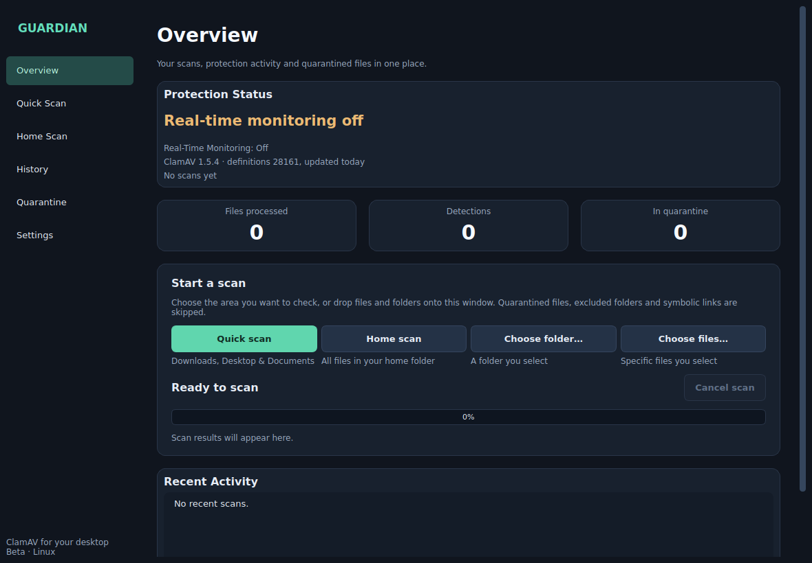

# Guardian Antivirus

[](https://github.com/PriceyLewis/Guardian-AntiVirus/actions/workflows/tests.yml)


## Portfolio release status

**v1.1.0 · Tested 22 October 2026**

Guardian 1.1 is installable with `pipx`, adds file and command-line scanning, monitored and excluded folders, quarantine fingerprints and clean-up, definitions status, guided on-access blocking, a light theme and keyboard shortcuts. The regression suite and the public demo journeys were re-run before publication.

[Read the v1.1.0 release notes](./RELEASE_NOTES_v1.1.0.md) · [v1.0.0 release notes](./RELEASE_NOTES_v1.0.0.md)

[Launch the interactive demo](https://priceylewis.github.io/Guardian-AntiVirus/) · [View the recruiter case study](https://priceylewis.github.io/projects/guardian.html)

A Linux desktop security application built with Python, PySide6, ClamAV and SQLite. Guardian coordinates malware scanning, asynchronous folder monitoring, quarantine workflows, persistent history and defensive settings behaviour through a desktop UI.



## Interactive browser demo

[Launch the interactive demo](https://priceylewis.github.io/Guardian-AntiVirus/)

A recruiter-facing static demo now lives in `web-demo/`. It mirrors Guardian's real interface and workflows using a safe virtual filesystem rather than pretending a browser can provide native antivirus protection.

The demo includes:
- Quick, Home, controlled-folder and chosen-file scan journeys;
- safe simulated detection and quarantine, with SHA-256 fingerprints and a CSV report;
- restore/delete quarantine actions;
- scan history with result and period filters and CSV export;
- real-time monitoring simulation that respects monitored and excluded folders, with pause/resume;
- definitions status and last-scan summary;
- schedule, retention and appearance settings (light and dark, following the system by default);
- the on-access blocking setup steps the native app generates;
- persisted settings through browser localStorage;
- explicit links back to the native PySide6/ClamAV source.

The browser demo is tested in Chromium after the native Python regression suite passes, then published to the `gh-pages` branch.

**Important:** the browser build never scans a recruiter's real files. The native Linux application remains the implementation that integrates with ClamAV, filesystem events, quarantine storage and SQLite.


> **Portfolio scope:** Guardian is a beta ClamAV frontend and filesystem monitor, not a certified antivirus. On its own it detects threats after files are written; blocking files before they open needs ClamAV's on-access scanner, which Guardian helps you set up. Released under the [MIT licence](./LICENSE).

## Why this project stands out

Guardian goes beyond a normal CRUD application. It demonstrates:

- Linux-specific process and filesystem integration;
- long-running/background work without blocking the UI;
- ClamAV daemon use with CLI fallback;
- quarantine, restore and overwrite protection;
- SQLite-backed scan history;
- settings rollback when persistence/runtime updates fail;
- tray, notification and login-startup integration;
- explicit failure states instead of treating scanner errors as clean files;
- automated pytest regression coverage.

## Recruiter walkthrough

A useful local demo takes only a few minutes:

1. Open the Overview page and show Quick / Home / Custom scan options.
2. Run a disposable-folder scan.
3. Use the official harmless EICAR test file if live ClamAV is configured.
4. Show the detection result and quarantine record.
5. Open History and demonstrate search/filter/export behaviour.
6. Open Quarantine and demonstrate the SHA-256 fingerprint and safe restore/delete controls.
7. Toggle monitoring/settings and show that UI state reflects the runtime behaviour.

No live malware is required or recommended.

## Install

Guardian needs Linux, Python 3.10+ and ClamAV (see below). Install it as an isolated app with [pipx](https://pipx.pypa.io/):

```sh
pipx install git+https://github.com/PriceyLewis/Guardian-AntiVirus.git
guardian --install-menu-entry   # optional: add Guardian to your application menu
guardian
```

`guardian --remove-menu-entry` removes the menu entry, and `guardian --help` lists the options.

### Run from a checkout

```sh
python -m venv .venv
. .venv/bin/activate
python -m pip install -r requirements.txt
python guardian.py
```

### Command-line scanning

```sh
guardian --scan ~/Downloads/suspicious.zip ~/Projects
guardian --scan --report-only /media/usb
```

Each file prints `OK`, `FOUND <signature>` or `ERROR <reason>`, followed by a summary. Detections are quarantined unless `--report-only` is given. Exit codes follow `clamscan`: `0` nothing found, `1` threat found, `2` errors only. Results appear in the app's History.

From a checkout, use `python guardian.py --scan …` instead.

### Keyboard shortcuts

| Keys | Action |
| --- | --- |
| Ctrl+1 – Ctrl+4 | Overview, History, Quarantine, Settings |
| Ctrl+F | Search the current page |
| F5 | Refresh the current page |
| Delete | Delete the selected quarantined files (with confirmation) |
| Ctrl+Q | Quit Guardian |

### ClamAV

Install ClamAV and its signature databases using your Linux distribution's supported packages and maintain definitions with FreshClam.

Guardian first attempts the local ClamAV daemon and then falls back to `clamscan`. A missing engine, unreadable file or scan timeout is surfaced as an error rather than a clean result.

## Architecture

```text
PySide6 / Qt UI
       |
       +--> Scan manager ------> clamd / clamscan
       |
       +--> Watcher -----------> filesystem events
       |
       +--> Quarantine --------> protected local files
       |
       +--> Settings ----------> runtime + persistence
       |
       +--> SQLite ------------> scan/history state
       |
       +--> Notifier / tray / autostart
```

The implementation keeps scanning, monitoring, persistence, quarantine and notification concerns separate rather than embedding system work directly in the UI layer.

## Behaviour and defensive decisions

- Quick Scan checks existing Downloads, Desktop and Documents folders.
- Home Scan checks the user's home directory. Custom Scan checks a selected folder, selected files, or files and folders dropped onto the window.
- Real-time monitoring watches a user-editable folder list (Downloads, Desktop and Documents by default). It can be paused for an hour from the tray and resumes automatically.
- Symlinks and Guardian's own quarantine, database and config files are excluded, so monitoring never rescans its own history writes.
- The ClamAV daemon is tried on the Debian/Ubuntu, Arch and Fedora socket paths. Without it, files are batched into one `clamscan` run per 100 files instead of reloading signatures for every file.
- Threats are moved into a private quarantine directory and recorded in SQLite.
- Restore refuses to overwrite an existing destination.
- Monitoring reacts asynchronously to creation, modification, move and close events; it is detection, not access prevention. One write raising several events is scanned once.
- Disabling monitoring pauses dispatch immediately and stops the observer cleanly on exit.
- Cancelled scans are not presented as completed scans.
- Definition freshness is not falsely asserted by the app.
- CSV export escapes spreadsheet-formula prefixes in exported values.
- History can be cleared after confirmation; quarantined files are unaffected.
- Real-time monitoring waits until a file has been quiet for a second before scanning it, on its own thread, and ignores browser partial-download files (`.part`, `.crdownload`, …) until they are renamed.
- Overview shows the ClamAV signature version and age from `clamscan --version`, and warns when definitions are missing or more than 7 days old.
- Each scan run is recorded with its duration, so the last scan survives restarts.
- Excluded folders (Settings) are skipped by scans and monitoring.
- Quarantine records each file's SHA-256 so a detection can be looked up (for example on VirusTotal) without uploading it. Several records can be restored or deleted at once, and the list exports as CSV.
- Settings can run FreshClam to update definitions and explains when the system FreshClam service or administrator rights are needed instead.
- History filters by result and by period (24 hours, 7 days, 30 days).
- When a scan finishes while the window is hidden, a desktop notification reports the result.
- An optional daily Quick scan runs while Guardian is open if no scan has run in 24 hours; cancelling it postpones it to the next day.
- Only one Guardian instance runs per data directory, so monitors never duplicate.
- The login entry starts Guardian minimised to the tray (`--minimized`) when a tray is available.

## Tests

```sh
python -m pip install pytest
QT_QPA_PLATFORM=offscreen python -m pytest -q
```

Regression coverage includes:

- scanner status and error handling;
- archive-policy behaviour;
- quarantine / restore / delete;
- overwrite protection;
- database thread ownership;
- worker failures;
- settings persistence and rollback;
- batched clamscan parsing and monitoring self-exclusion;
- monitoring debounce, exclusions, definitions freshness and scheduled scans;
- command-line exit codes, file and drag-and-drop scans, monitored-folder changes, pause/resume;
- quarantine fingerprints, schema migration, bulk actions and reports;
- navigation and scan lifecycle.

Scanner tests use controlled engine responses, so they verify application behaviour rather than claiming to prove live antivirus detection.

## Target-machine verification

Before treating a build as fully verified on a Linux desktop, check:

- ClamAV daemon permissions and CLI fallback;
- current signature databases;
- official harmless EICAR detection in a disposable folder;
- notification delivery;
- tray close/quit behaviour and the pause/resume menu;
- the application-menu entry and drag-and-drop from your file manager;
- FreshClam updates from Settings, and on-access blocking if you enable it;
- login autostart;
- performance across large folder trees and active downloads.

The UI is exercised offscreen at 1180×820 and at the 880×640 minimum in both themes; a regression test fails if any page needs sideways scrolling.

## Data location

Guardian keeps its settings, history database, quarantine and logs in `$XDG_DATA_HOME/guardian` (normally `~/.local/share/guardian`). Set `GUARDIAN_DATA_DIR` to use another writable directory.

Versions before 1.1 stored data beside the code. On first launch Guardian moves that data (settings, history database and quarantine) to the new location and updates quarantine records to match. It never overwrites data already there.

The diagnostic log is `logs/guardian.log` in the data directory (rotated at 1 MB, three backups). Settings › Open log folder opens it.

## What this demonstrates

Python desktop development · Linux integration · defensive programming · asynchronous work · SQLite · security tooling · pytest · CI · careful product claims.
